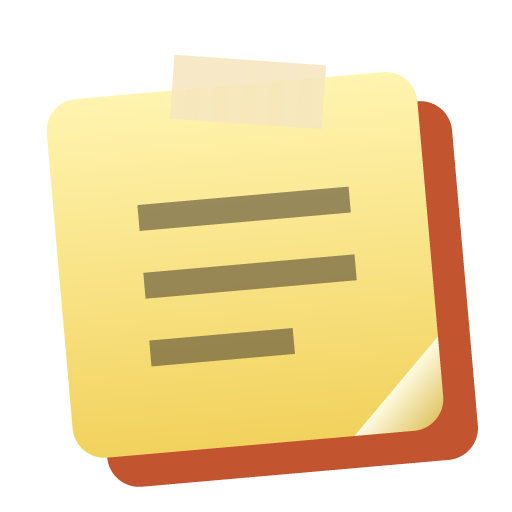

<p align="center">
  
</p>

<h1 align="center">LavaNotes</h1>

<p align="center">
  <b>Desktop sticky notes that look like real paper — scattered, tilted sheets with washi tape, images and tables, and a ✓ to tear off what is done.</b>
</p>

<p align="center"><b>English</b> · <a href="README.zh-CN.md">简体中文</a></p>

---

## Features

- **Every note is its own window**: transparent and paper-shaped, with grain, shadow and washi tape. New notes lean left and right in turn and are spread out instead of piling up on one spot; the one you click comes to the front.
- **Window layer for new notes**, chosen in Manager → Settings:
  - **Normal** — an ordinary window that other apps can cover;
  - **On top** — always in front;
  - **Pinned to the desktop** — sits above the desktop icons and below every window, so you only see it where the desktop shows. **Show Desktop (Win+D) and Minimize All (Win+M) leave it alone.**
- **Resize from the folded bottom-right corner**, even while editing. Move a note by its top strip, tape or side edges.
- **Rich text**: bold and underline on the toolbar; italic, strikethrough and **Translate** in its T menu; bullet and numbered lists; checklists — click a box to check it, right-click it to mark the item in progress (the whole row glows in the paper's colour, a light sweeps along it and the box sends out ripples); every item remembers when it was added, started and checked. Each check plays one of 10 small celebrations at random (a bouncing tick, a highlighter stroke, confetti, stars, ripples, a coin, a shine, bubbles, hearts, sparks); checks in a row climb a scale and show a streak, and finishing the whole list throws confetti.
- **Translate**: translates the selection, or the whole note paragraph by paragraph. Replace the original (lists, checkboxes, tables and images stay in place), insert the translation below, or copy it. Uses the model chosen under **AI settings**.
- **Images**: insert, paste a screenshot or drag a file in; drag a corner to resize. Images are stored as separate files, so notes stay light.
- **Simple tables**: insert 3×3, add or remove rows and columns, toggle the header row, drag column widths.
- **In progress**: ▷ at the top right marks the note you are working on. A halo in the note's own paper colour breathes around it, two lights run along its edges and a sheen sweeps across the paper now and then; the bar shows “进行中” with the date and time it started (work often spans days), and the mark becomes a slowly breathing dot; click again to stop.
- **Done — celebrate it**: the ✓ at the top right means done, and one of 15 finishing animations plays at random, never the same twice in a row: torn off and fluttering down, confetti, fireworks, a rubber stamp, a paper plane, shattering, bubbles, a star, blown away like sand, a whirlpool, hearts, balloons, a big tick, pixel rain or burning away. They play across the screen around the note, each with its own sound, and end with how many things you have finished today. Finished notes can be put back from the manager.
- **Notes come in with style**: a new or restored note appears with one of 15 random animations (pop, drop, flip, unroll, swing, wipe, iris, focus, slap, spin, flap, sticker, jelly, sparkle, rise) and a sound; at startup they come in one after another, quietly.
- **Sound and settings**: every sound is synthesised on the fly (tearing paper, party poppers, fireworks, bubbles, a stamp, chimes …). Manager → Settings turns the animations or the sound off, sets the volume, and lets you try each of the 15 finishing animations. When Windows' animation effects are off, notes leave with the short tear only.
- **Abandon**: ⋯ → Abandon crumples a note you gave up on. It disappears from the desktop but is kept (filter the manager by “Abandoned”), can be put back, and still counts in the statistics.
- **Statistics** by week or month: notes written, torn off and abandoned, checklist items added and checked, and how long things took — an in/out chart over twelve periods, a lifeline per note across the period, the hours or days you are busiest, and the oldest unchecked items. Ask the model for a reading of the period: topics, rhythm and what seems stuck.
- **AI settings** work like LavaTranslate: sign in with a ChatGPT Plus / Pro plan, or paste an API key for Gemini, OpenAI, DeepSeek, Qwen, Zhipu GLM, Kimi, Doubao, Claude, OpenRouter or any OpenAI-compatible service (the provider is recognised from the key; keys are encrypted on this PC). The model list shows prices from models.dev.
- **Manager**: opens on the statistics; the notes page searches every note and filters by open / torn off / abandoned / all (notes in progress carry a badge), where torn-off and abandoned notes can be put back or deleted.
- **Tray app** that starts with Windows and updates itself from GitHub Releases. On Windows, right-clicking the icon opens LavaNotes' own menu with the number of notes and how many are in progress, and a switch for starting with Windows.

## Download

Get `LavaNotes-Setup-<version>.exe` from [Releases](https://github.com/chengcczzjj/LavaNotes/releases/latest). Windows 10 / 11 x64. The installer is not code-signed, so SmartScreen may warn on first run; choose “Run anyway”.

## Data

Everything stays on your PC in `%APPDATA%\LavaNotes`: `notes-index.json` (positions, colours, layers, when a note was torn off) with a backup copy, one `notes/<id>.json` per note body, `assets/<sha256>.<ext>` for images, `settings.json`, and `ai-settings.json` (model settings, keys encrypted) with `ai-insights.json` (saved readings). Note text is sent to your model service only when you click Translate or ask for a reading. Files are written to a temporary file and renamed into place; a damaged index is moved aside and restored from the backup, never overwritten.

Other apps can open LavaNotes with `lavanotes://new`, `lavanotes://manager` and `lavanotes://open`.

## Development

Node.js 22.

```bash
npm install
npm run dev           # run in development
npm test              # typecheck + lint + unit tests
npm run test:smoke    # build, then drive real Electron windows (use xvfb-run on Linux)
npm run dist          # build the Windows installer (on Windows)
```

Pushing a `v*` tag, or running the **Release Windows** workflow by hand with the tag to create, makes GitHub Actions test, build and publish the release on Windows. Design notes: [docs/architecture.md](docs/architecture.md).

## License

[MIT](LICENSE)
